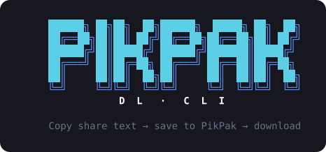
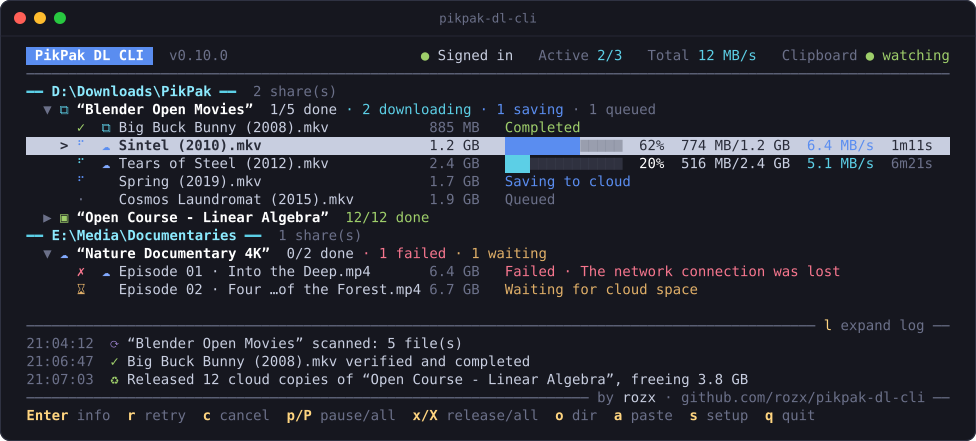
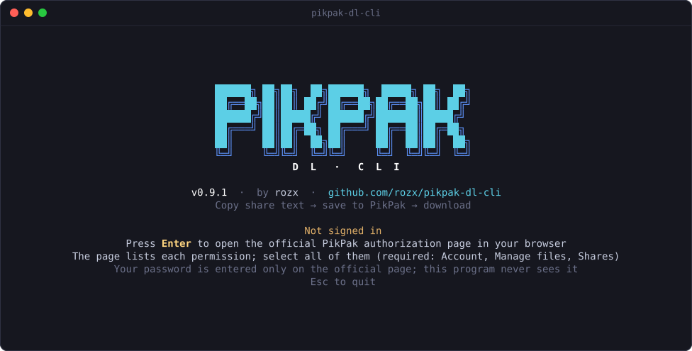
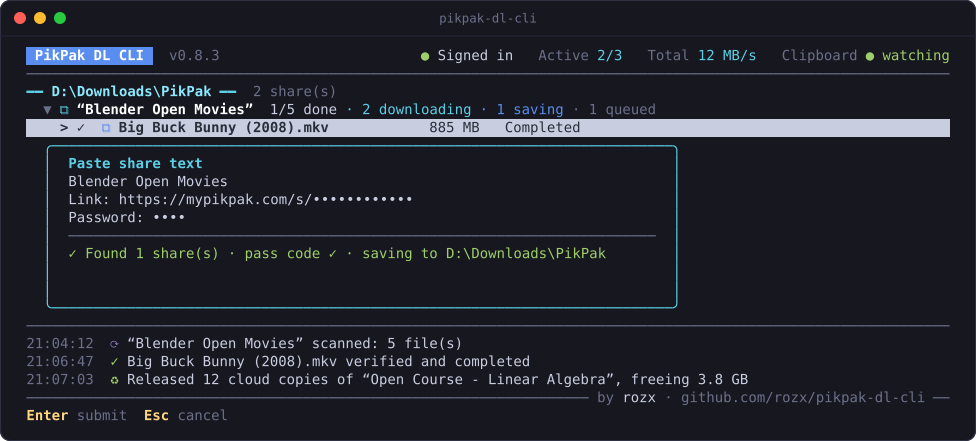
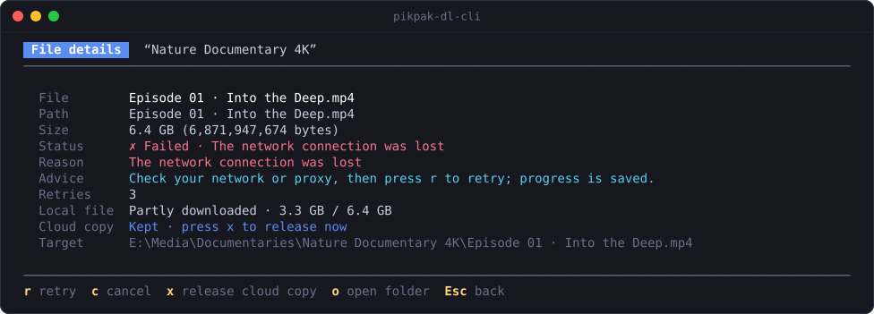
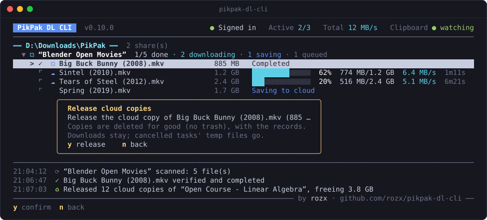
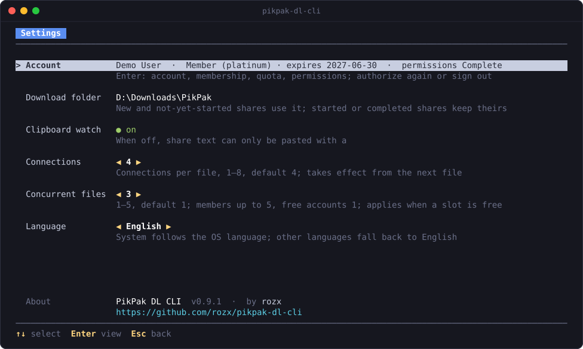

<p align="center">
  
</p>

<p align="center">
  <a href="README.md">简体中文</a> · <b>English</b> · <a href="README.ja.md">日本語</a>
</p>

<p align="center">
  <b>Copy the share text. It handles the rest.</b><br>
  Saves the files in a PikPak share one at a time, downloads and verifies them into a local folder, and frees cloud space as needed.
</p>

<p align="center">
  <a href="https://github.com/rozx/pikpak-dl-cli/releases/latest"></a>
  <a href="https://github.com/rozx/pikpak-dl-cli/releases"></a>
  <a href="https://github.com/rozx/pikpak-dl-cli/actions/workflows/release.yml"></a>
  <a href="https://github.com/rozx/pikpak-dl-cli/stargazers"></a>
  <a href="LICENSE"></a>
  <br>
  
  
  
  <a href="https://github.com/rozx/pikpak-dl-cli/commits/main"></a>
</p>

<p align="center">
  
</p>

## Why you need it

You have a PikPak share and want its files on your own computer. Usually that takes a lot of clicking:

1. Open the link, enter the pass code, and save the files to your own cloud drive.
2. If your drive cannot hold the whole share, save only part of it, download that, delete it, then save the next batch.
3. Download the files one by one in the web page or the app. When the network drops, a large file often starts over.
4. Go back to the cloud drive and delete those saved copies by hand so they do not fill it up.

The bigger the share and the more files it has, the more tedious this gets. PikPak DL CLI automates all of it: **you only copy the share text**. It uses your cloud drive as a staging area and saves only the files it needs at the moment. Once a file is downloaded and verified, it reclaims the copies it created itself, but only when space runs short.

## Highlights

- **Copy and it downloads**: watches the clipboard in the background and queues any share text that contains a link and a pass code. You can also press `a` in the interface to paste.
- **The cloud drive is only a staging area**: saves files one at a time and reclaims completed copies only when the next file does not fit, oldest first. Even a huge share never needs the same amount of cloud space.
- **Touches only its own copies**: every copy is backed by a save record, and the remote details are checked again before deletion. Files you saved to your drive yourself are never deleted, even if their name and size match.
- **Resumable downloads, verified content**: large files download in segments over several connections. After a network drop, quit or restart, downloads continue where they stopped. When a download finishes, it is compared with the GCID that PikPak provides; on a mismatch it does not count as completed.
- **Never handles your password**: you authorize on the official PikPak page in your browser. Tokens and pass codes are kept in the system credential store (Windows Credential Manager, macOS Keychain, Linux Secret Service).
- **A clear terminal interface**: shows the status, progress, speed and time left of every share and file, grouped by download folder. Pause, resume, retry, cancel and releasing cloud copies each take a single key.
- **A single executable**: separate builds for Windows, macOS and Linux, each with the runtime built in. Download and run.
- **简体中文, English, 日本語**: the interface, command line and authorization page follow the system language. You can also choose one yourself.

## Quick start

### 1. Download

Download the file for your platform from [Releases](https://github.com/rozx/pikpak-dl-cli/releases/latest):

| Platform | File |
| --- | --- |
| Windows x64 | `pikpak-dl-cli-windows-x64.exe` |
| Windows arm64 | `pikpak-dl-cli-windows-arm64.exe` |
| macOS Apple silicon | `pikpak-dl-cli-darwin-arm64` |
| macOS Intel | `pikpak-dl-cli-darwin-x64` |
| Linux x64 (glibc) | `pikpak-dl-cli-linux-x64` |
| Linux arm64 (glibc) | `pikpak-dl-cli-linux-arm64` |

`SHA256SUMS.txt` lists the checksum of each file. On macOS and Linux, make the file executable first. Use the name of the file you downloaded, for example on Linux x64:

```sh
chmod +x ./pikpak-dl-cli-linux-x64
```

If macOS says it cannot verify the developer, remove the download quarantine flag and run it again (on an Intel Mac, use `pikpak-dl-cli-darwin-x64`):

```sh
xattr -d com.apple.quarantine ./pikpak-dl-cli-darwin-arm64
```

### 2. Sign in

Run it in a terminal without arguments to open the full-screen interface (on Windows, Windows Terminal is recommended):

```powershell
.\pikpak-dl-cli-windows-x64.exe
```

On first launch, press Enter to open the official PikPak authorization page in your browser. The page lists each permission. Select all of them; Account, Manage files and Shares are required. You enter your password only on the official page.

<p align="center">
  
</p>

After authorizing, choose a download folder (it is created if it does not exist). The main panel opens and clipboard watching starts.

### 3. Copy the share text

Copy a complete share text so that the link and the pass code are on the clipboard together, for example:

```text
https://mypikpak.com/s/synthetic-demo
Password: demo
```

The label in front of the pass code can be `password`, `pass code`, `提取码` or `密码`.

The new task appears right away. It is then scanned, saved, downloaded and verified, and the files end up in a folder named after the share title inside your download folder. You can also press `a` to open the paste box, which shows in real time how many shares and pass codes it found:

<p align="center">
  
</p>

## Usage

### Main panel

The list is grouped by local download folder, and each share lists its files. After the share title comes a summary of what is done. File rows show the size and status; files being downloaded also show progress, speed and time left. The title bar shows the sign-in status, the number of files downloading at once with their combined speed, cloud usage, free local space and the clipboard watch status. Recent events are at the bottom.

The icon in front of a name shows where the file is now:

| Icon | Meaning |
| --- | --- |
| `⧉` | Both local and in the cloud |
| `▣` | Local only (gray means only partly downloaded) |
| `☁` | Only in the PikPak cloud drive |
| Blank | Neither |

### Keys

| Key | Action |
| --- | --- |
| `↑` `↓` / `←` `→` / `Enter` | Select; collapse or expand a share; view file details |
| `r` | Retry the selected file or share |
| `c` | Cancel (asks for confirmation). Local files, saved progress and cloud copies are kept; press `r` later to resume |
| `p` / `P` | Pause or resume the selected item; pause all, or start all when something is paused. Paused state survives a restart |
| `x` / `X` | Release the cloud copies of the selected item; release the cloud copies of all completed tasks (both ask for confirmation) |
| `o` | Open the download folder |
| `a` | Paste share text |
| `s` | Settings |
| `q` / `Ctrl+C` | Quit (asks for confirmation). Downloads stop at a safe point and save their progress; press `Ctrl+C` again to quit immediately |

These actions take effect immediately during downloads; there is no need to wait for the current file to finish. The window must be at least 60×15, and a 100-column window fits the whole line of key hints. Set the `NO_COLOR` environment variable to turn off colors.

### File details

Press Enter on a file to see its details: the full path and size, the reason and advice for a failure, the number of retries, the local download progress, the cloud copy status and the local target path.

<p align="center">
  
</p>

### Cloud space and releasing

By default you do not need to manage cloud space. Only when the next file does not fit does the program reclaim completed copies, oldest first, and it stops as soon as there is enough room. Nothing is deleted early while there is enough cloud space.

To free space right away, select a file or share and press `x`, or press `X` to release the copies of all completed tasks. The confirmation dialog shows what will be released and how much space it frees. Deletion is permanent (nothing goes to the trash), and local files are kept:

- When the copies of a completed task are released, its record is deleted too, and it disappears from the list.
- When the copy of an unfinished file is released, its progress is kept. Resuming saves it from the share again, which fails if the share has expired.
- Files being downloaded and copies not created by this tool are not released; the interface only explains why.

<p align="center">
  
</p>

### Settings

Press `s` to open Settings:

- **Account**: press Enter to see the account, membership, cloud quota and granted permissions. From there you can authorize again or sign out.
- **Download folder**: new shares and shares not yet started use the new folder. Shares already started keep their folder.
- **Clipboard watch**: when off, you can only paste with `a`.
- **Connections**: connections used at once for a single file, 1–8, default 4.
- **Concurrent files**: 1–5, default 1. Members get up to 5; free accounts only 1.
- **Language**: use ←→ to switch between System, 简体中文, English and 日本語. The interface switches to the new language right away.

<p align="center">
  
</p>

### Interface language

Simplified Chinese, English and Japanese are supported. The full-screen interface, command-line output, error messages and the authorization page in the browser all use the same language. By default it follows the system language: it reads the environment variables `LANGUAGE`, `LC_ALL`, `LC_MESSAGES` and `LANG` in that order, and on Windows also the system display language. Chinese systems (including Traditional Chinese) show Simplified Chinese, Japanese systems show Japanese, and all other languages show English.

To fix a language, switch it in Settings or run `config --language <auto|zh-CN|en|ja>` (`auto` goes back to following the system). Share titles and file names stay as they are. The JSON fields and reason codes in `status` output do not change with the language, so they are safe to use in scripts.

### Command line

When output is redirected or it runs in a script, the full-screen interface does not open, and you can use subcommands (Windows shown; on other platforms use the matching file name):

```powershell
.\pikpak-dl-cli-windows-x64.exe login                       # Sign in through the browser, or verify the existing session
.\pikpak-dl-cli-windows-x64.exe watch --output D:\Downloads  # Plain-text watching in the foreground
.\pikpak-dl-cli-windows-x64.exe status                      # View task status read-only; works while running
.\pikpak-dl-cli-windows-x64.exe retry f_1a2b3c4d             # Retry a file task
.\pikpak-dl-cli-windows-x64.exe cancel s_1a2b3c4d            # Cancel a share task
.\pikpak-dl-cli-windows-x64.exe config --connections 6
.\pikpak-dl-cli-windows-x64.exe config --files 3
.\pikpak-dl-cli-windows-x64.exe config --language en         # Interface language: auto, zh-CN, en, ja
.\pikpak-dl-cli-windows-x64.exe logout                      # Remove the tokens and keep tasks
```

Replace `f_1a2b3c4d` and `s_1a2b3c4d` with a file task ID (starting with `f_`) or share task ID (starting with `s_`) listed by `status`. `watch` prints a progress line every time progress crosses another 10% or every 30 seconds. Apart from `status`, commands that change anything require stopping the running interface or `watch` first. See `--help` for the full list.

### Platform notes

**Linux** builds need glibc 2.28 or later. musl distributions such as Alpine are not supported. Runtime dependencies:

- Credentials: libsecret and a working Secret Service (GNOME Keyring, KWallet and so on), with the keyring unlocked. Without one, the sign-in cannot be saved; the program never falls back to plain text.
- Clipboard: `wl-paste` (wl-clipboard) on Wayland, `xclip` or `xsel` on X11. Without a graphical session, press `a` to paste.
- Opening the browser and the download folder: `xdg-open`. If that fails, open the local address shown in the terminal yourself.
- The file system of the download folder must support no-overwrite renames (ext4, xfs, btrfs and so on).

**Task database location**: `%LOCALAPPDATA%\PikpakDownloader` on Windows, `~/Library/Application Support/PikpakDownloader` on macOS, and `$XDG_DATA_HOME/PikpakDownloader` on Linux (`~/.local/share/PikpakDownloader` when unset).

### Security and privacy

- The program never collects your account password. Tokens and pass codes are kept only in the system credential store; the task database holds only references to them.
- Share links, pass codes, tokens and signed download URLs never appear in interface events, logs or the task database, and the raw clipboard content is never saved.
- Only copies with proof of creation are deleted, and the remote identity, name, folder and content fingerprint are checked again before deletion. The trash is never emptied, and folders are never deleted recursively.
- Files being downloaded are kept as `.pikpak-part` temporary files and renamed without overwriting when done. If a file with the same name already exists, a suffix is added.

### More documentation

- [Signing in and authorizing again](docs/en/login.md)
- [Copying share text](docs/en/clipboard.md)
- [Downloading, verification and recovery](docs/en/downloads.md)
- [Cloud space and reclaiming](docs/en/cloud-space.md)
- [Local state and recovery](docs/en/state-and-recovery.md)

> [!NOTE]
> The project is at the 0.x stage. Real-world testing has focused on Windows x64; macOS, Windows arm64 and Linux desktops have not yet been fully tested on real machines. Known issues are listed in the [release notes](https://github.com/rozx/pikpak-dl-cli/releases) of each version. Bug reports are welcome as [Issues](https://github.com/rozx/pikpak-dl-cli/issues).

## Development

The stack is TypeScript and [Bun](https://bun.sh) 1.4.2. The full-screen interface is built on [Ink](https://github.com/vadimdemedes/ink) (React).

```sh
bun install --frozen-lockfile
bun run check                    # Native module (macOS only) + type check + all tests
bun run dev                      # Run from source, watch for changes and restart on save
bun run start --help             # Run once from source without watching
bun run build bun-windows-x64    # Single-file build to dist/; defaults to the current platform
bun scripts/preview-tui.tsx      # Preview the full-screen interface with mock data; does not touch the task database
bun scripts/screenshots.tsx      # Regenerate the screenshots for each language in docs/images/ from mock data
```

- Build targets are `bun-{windows,darwin,linux}-{x64,arm64}`. The macOS native module needs the Xcode Command Line Tools and the Node-API headers; `NODE_API_HEADERS` can point to the header directory. Release builds already include the runtime and native support, so users do not need these tools.
- The icon and file information of the Windows build are written at build time; `scripts/icon.ts` generates the icon from pixel art. The macOS and Linux executables have no icon.
- `PIKPAK_DOWNLOADER_STATE_DIR` points the task database to another directory, for tests and local experiments.
- The shares, files and accounts in the screenshots are fictional. After changing the interface, run `bun scripts/screenshots.tsx` to update them: Chinese goes to `docs/images/`, English and Japanese to `docs/images/en/` and `docs/images/ja/`.
- Interface text lives in `src/i18n/messages/`. `zh-CN.ts` is the reference; the type check fails if `en.ts` or `ja.ts` is missing an entry.

See [AGENTS.md](AGENTS.md) for architecture, conventions and testing. Requirement changes go through the [OpenSpec](openspec/) process, and the specs are in `openspec/specs/`. AGENTS.md, the specs and the code comments are written in Chinese. To release, write `docs/releaseNotes/vx.y.z.md` on a `release/x.y.z` branch and open a PR with the `release` label. After it is merged, GitHub Actions checks and builds on all three platforms and creates the release.

## License

[MIT](LICENSE) © rozx
