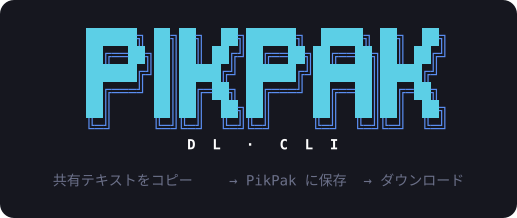
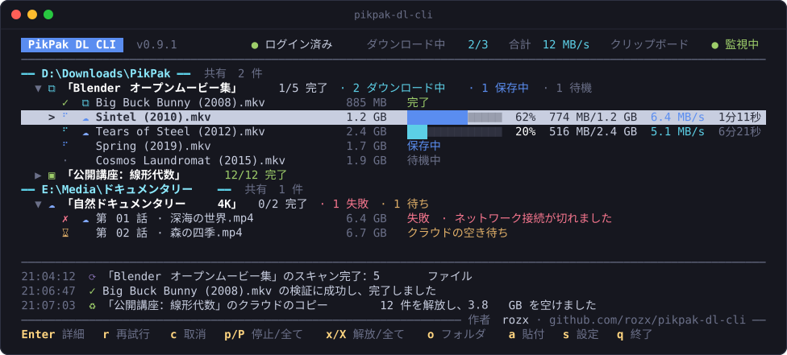
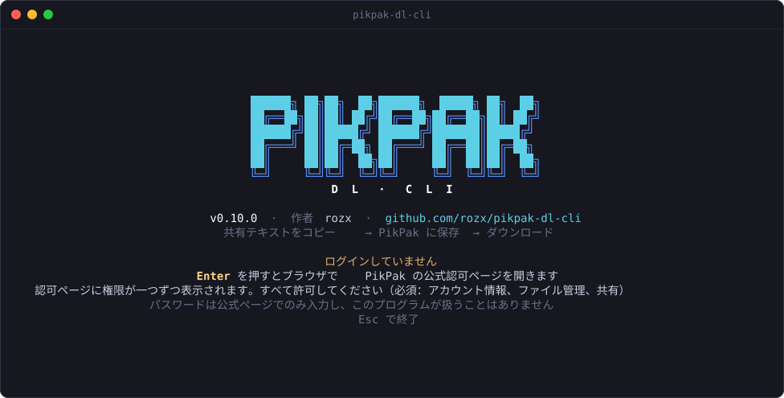
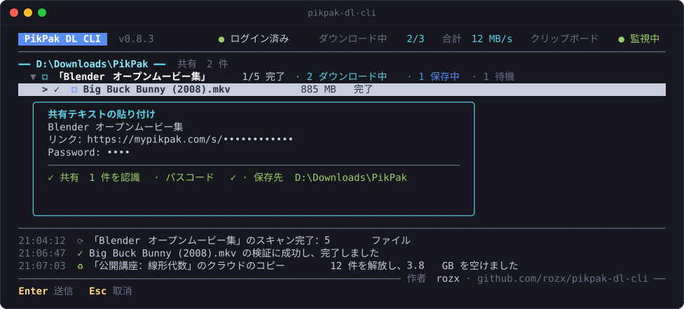
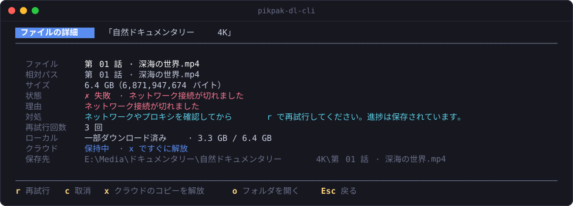
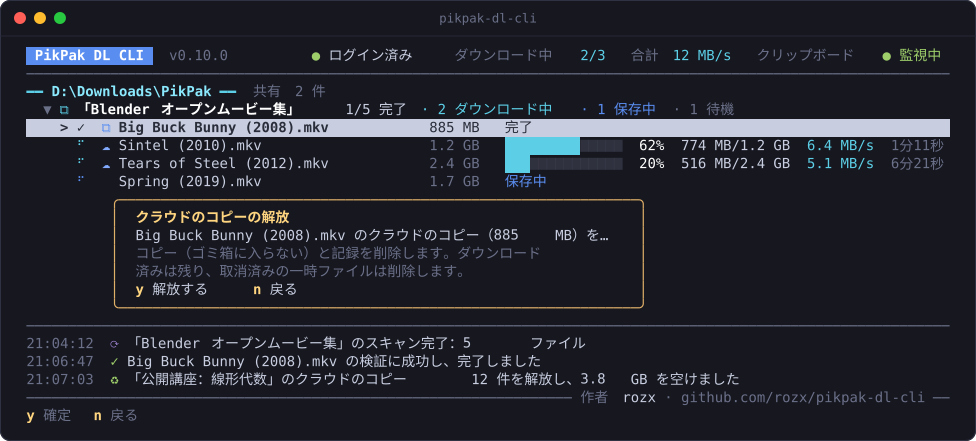
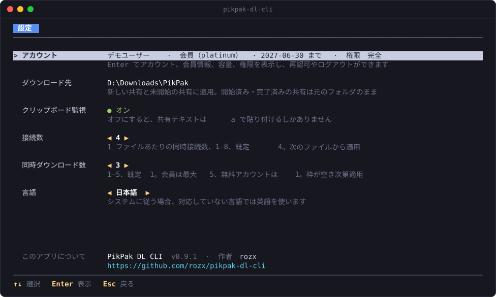

<p align="center">
  
</p>

<p align="center">
  <a href="README.md">简体中文</a> · <a href="README.en.md">English</a> · <b>日本語</b>
</p>

<p align="center">
  <b>共有テキストをコピーするだけ。あとはおまかせ。</b><br>
  PikPak の共有に含まれるファイルを一つずつ保存し、ダウンロードと検証を済ませてローカルのフォルダに置きます。クラウドドライブの容量は必要に応じて空けます。
</p>

<p align="center">
  <a href="https://github.com/rozx/pikpak-dl-cli/releases/latest"></a>
  <a href="https://github.com/rozx/pikpak-dl-cli/releases"></a>
  <a href="https://github.com/rozx/pikpak-dl-cli/actions/workflows/release.yml"></a>
  <a href="https://github.com/rozx/pikpak-dl-cli/stargazers"></a>
  <a href="LICENSE"></a>
  <br>
  
  
  
  <a href="https://github.com/rozx/pikpak-dl-cli/commits/main"></a>
</p>

<p align="center">
  
</p>

## なぜ必要か

PikPak の共有を受け取って、中のファイルを自分のパソコンにダウンロードしたいとき、ふつうは次のような手間がかかります。

1. リンクを開いてパスコードを入力し、ファイルを自分のクラウドドライブに保存する。
2. 共有全体がクラウドドライブに収まらなければ、一部だけ保存してダウンロードし、削除してから次のまとまりを保存する。
3. Web やクライアントで一つずつダウンロードする。ネットワークが切れると、大きなファイルは最初からやり直しになりがち。
4. ダウンロードが終わったらクラウドドライブに戻り、容量を圧迫しないよう保存したコピーを手作業で削除する。

共有が大きく、ファイルが多いほど、この繰り返しは面倒になります。PikPak DL CLI はこの流れをまるごと自動化します。**やることは共有テキストをコピーするだけです。** クラウドドライブを中継地点として使い、必要なファイルだけを一度に保存します。ダウンロードと検証が済んだあと、容量が足りなくなったときには、自分が作成したコピーを自動で回収します。

## 主な機能

- **コピーするだけでダウンロード**：バックグラウンドでクリップボードを監視し、リンクとパスコードを含む共有テキストを見つけると自動でキューに追加します。画面で `a` を押して貼り付けることもできます。
- **クラウドドライブは中継地点**：ファイルを一つずつ保存し、次のファイルが収まらないときにだけ、完了したコピーを古い順に回収します。共有がどれほど大きくても、同じだけのクラウド容量は必要ありません。
- **自分が作成したコピーにしか触れない**：どのコピーにも保存の記録が証拠として残り、削除の前にはリモートの情報を改めて確認します。自分でクラウドドライブに置いたファイルは、名前やサイズが同じでも削除しません。
- **再開と内容の検証**：大きなファイルは複数の接続で分割ダウンロードします。ネットワークの切断、終了、再起動のあとも途中から再開します。ダウンロード後は PikPak が提供する GCID と照合し、一致しなければ完了とは見なしません。
- **パスワードを扱わない**：ブラウザで PikPak の公式ページから認可します。トークンとパスコードはシステムの資格情報ストア（Windows 資格情報マネージャー、macOS キーチェーン、Linux Secret Service）に保存します。
- **ひと目でわかるターミナル画面**：ダウンロード先ごとに、各共有とファイルの状態、進捗、速度、残り時間を表示します。一時停止、再開、再試行、キャンセル、クラウドのコピーの解放はいずれもキー一つで操作できます。
- **単一の実行ファイル**：Windows、macOS、Linux それぞれに専用のファイルがあり、ランタイムを内蔵しているので、ダウンロードしてすぐに使えます。
- **简体中文、English、日本語**：画面、コマンドライン、認可ページはシステムの言語に合わせて自動で切り替わります。手動で指定することもできます。

## クイックスタート

### 1. ダウンロード

[Releases](https://github.com/rozx/pikpak-dl-cli/releases/latest) から、お使いのプラットフォームのファイルをダウンロードします。

| プラットフォーム | ファイル |
| --- | --- |
| Windows x64 | `pikpak-dl-cli-windows-x64.exe` |
| Windows arm64 | `pikpak-dl-cli-windows-arm64.exe` |
| macOS Apple シリコン | `pikpak-dl-cli-darwin-arm64` |
| macOS Intel | `pikpak-dl-cli-darwin-x64` |
| Linux x64（glibc） | `pikpak-dl-cli-linux-x64` |
| Linux arm64（glibc） | `pikpak-dl-cli-linux-arm64` |

各ファイルのチェックサムは `SHA256SUMS.txt` にあります。macOS と Linux では、ダウンロード後にまず実行権限を付けてください。ファイル名はダウンロードしたものに置き換えます。Linux x64 の例：

```sh
chmod +x ./pikpak-dl-cli-linux-x64
```

macOS で開発元を検証できないと表示された場合は、ダウンロードの隔離属性を外してから実行してください（Intel Mac では `pikpak-dl-cli-darwin-x64` に置き換えます）。

```sh
xattr -d com.apple.quarantine ./pikpak-dl-cli-darwin-arm64
```

### 2. ログイン

ターミナルで引数なしで実行すると全画面インターフェースが開きます（Windows では Windows Terminal をおすすめします）。

```powershell
.\pikpak-dl-cli-windows-x64.exe
```

初回起動時に Enter を押すと、ブラウザで PikPak の公式認可ページが開きます。認可ページにはアプリの権限が一つずつ表示されるので、すべて選択してください。そのうちアカウント情報、ファイル管理、共有は必須です。パスワードは公式ページでのみ入力します。

<p align="center">
  
</p>

認可が終わったらダウンロード先を選びます（フォルダがなければ自動で作成します）。そのままメイン画面に移り、クリップボードの監視が始まります。

### 3. 共有テキストをコピーする

リンクとパスコードが同時にクリップボードに入るよう、共有テキスト全体をコピーします。例：

```text
https://mypikpak.com/s/synthetic-demo
パスワード: demo
```

PikPak の各言語のクライアントでコピーした共有テキストに対応しており、「パスワード」「パスコード」などのよく使われる表記も認識します。PikPak のウェブ版（日本語）でコピーしたテキストは「パスワード:」の後が空になっているため、パスコードを書き足してください。プログラムの起動時にすでにクリップボードにあるテキストは受け付けないため、起動後にコピーしてください。Linux ではテキストが変わったときだけを新しいコピーとみなすため、同じテキストをコピーし直す前に別の内容をコピーするか、`a` で貼り付けてください。クリップボードから共有を受け付けると、ターミナルのウィンドウが前面に出て、イベント欄にクリップボードから受け付けたことが表示されます。パスコードがないか正しくない場合、共有の行に理由が赤字で表示されます。共有を選んで Enter を押すとパスコードを入力して再スキャンできます。詳しくは[共有テキストのコピー](docs/ja/clipboard.md)を参照してください。

画面にはすぐ新しいタスクが表示され、スキャン、保存、ダウンロード、検証を順に進めます。最後に、ダウンロード先の中にある共有タイトル名のフォルダにファイルを置きます。`a` を押して貼り付け欄を開くこともでき、認識した共有の数とパスコードの有無がその場で表示されます。

<p align="center">
  
</p>

## 使い方

### メイン画面

一覧はローカルのダウンロード先ごとにまとめられ、各共有の下にそのファイルが並びます。共有タイトルの後ろには完了状況の集計があり、ファイルの行にはサイズと状態が、ダウンロード中のファイルにはさらに進捗、速度、残り時間が表示されます。タイトルバーにはログイン状態、同時にダウンロードしているファイル数と合計速度、クラウドの使用量、ローカルの空き容量、クリップボード監視の状態が、画面下部には最近のイベントが表示されます。

名前の前のアイコンは、ファイルが今どこにあるかを示します。

| アイコン | 意味 |
| --- | --- |
| `⧉` | ローカルとクラウドの両方にある |
| `▣` | ローカルだけにある（灰色は一部だけダウンロード済み） |
| `☁` | PikPak のクラウドドライブだけにある |
| 空白 | どちらにもない |

### キー操作

| キー | 動作 |
| --- | --- |
| `↑` `↓` / `←` `→` / `Enter` | 選択、共有の折りたたみ・展開、ファイルの詳細表示、パスコード待ちの共有へのパスコード入力 |
| `r` | 選択したファイルまたは共有を再試行 |
| `c` | 取消（確認あり）。ローカルファイル、進捗、クラウドのコピーはすべて残り、後で `r` で再開できます |
| `p` / `P` | 選択項目を一時停止・再開。すべて一時停止、または一時停止中の項目があればすべて開始。一時停止の状態は再起動後も保たれます |
| `x` / `X` | 選択項目のクラウドのコピーを解放、またはキャンセル済みのタスクを削除。完了・キャンセル済みのすべてのタスクのクラウドのコピーを解放（いずれも確認あり） |
| `o` | ダウンロード先を開く |
| `a` | 共有テキストを貼り付け |
| `l` | イベント欄を展開／折りたたみ |
| `s` | 設定 |
| `q` / `Ctrl+C` | 終了（確認あり）。ダウンロードは安全な位置で停止して進捗を保存します。もう一度 `Ctrl+C` を押すとすぐに終了します |

これらの操作はダウンロード中でもすぐに反映され、今のファイルが終わるのを待つ必要はありません。ウィンドウは 60×15 以上が必要で、100 列あればキー操作のヒントが一行に収まります。環境変数 `NO_COLOR` を設定すると色を無効にできます。

### ファイルの詳細

ファイルの上で Enter を押すと詳細が表示されます。フルパスとサイズ、失敗の理由と対処、再試行回数、ローカルの進捗、クラウドのコピーの状態、ローカルの保存先を確認できます。

<p align="center">
  
</p>

### クラウドの容量と解放

ふだんはクラウドドライブの容量を気にする必要はありません。次のファイルが収まらないときにだけ、完了したコピーを古いものから回収し、十分な空きができた時点で止めます。容量が足りているうちは、前もって何かを削除することはありません。

すぐに容量を空けたいときは、ファイルや共有を選んで `x` を押すか、`X` で完了・キャンセル済みのすべてのタスクのコピーを解放します。確認画面に解放する範囲とサイズが表示されます。削除は完全削除で（ゴミ箱には入りません）、ローカルファイルは残ります。

- 完了したタスクは、コピーを解放するとタスク記録も削除され、一覧から消えます。
- キャンセル済みのタスクも同様で、コピーを解放すると（クラウドにコピーがない場合はそのまま）記録と未完了の一時ファイル（`.pikpak-part`）を削除します。`x` でキャンセル済みのタスクを一覧から消せます。
- 未完了のファイルは、解放しても進捗が残り、再開すると共有から保存し直します。共有の期限が切れていると完了できません。
- ダウンロード中のファイルや、このツールが作成したものではないコピーは解放せず、画面にその理由だけを表示します。

<p align="center">
  
</p>

### 設定

`s` を押すと設定ページが開きます。

- **アカウント**：Enter でアカウント、会員情報、クラウド容量、認可権限を表示し、再認可やログアウトができます。
- **ダウンロード先**：新しい共有と未開始の共有は新しいフォルダを使い、開始済みの共有は元のフォルダのままです。
- **クリップボード監視**：オフにすると、共有テキストは `a` で貼り付けるしかありません。
- **接続数**：1 ファイルあたりの同時接続数。1–8、既定 4。
- **同時ダウンロード数**：1–5、既定 1。会員は最大 5、無料アカウントは 1 のみです。
- **言語**：←→ で「システムに従う」、简体中文、English、日本語を切り替えると、画面がすぐに新しい言語に変わります。

<p align="center">
  
</p>

### 表示言語

简体中文、English、日本語に対応しており、全画面インターフェース、コマンドラインの出力、エラーメッセージ、ブラウザの認可ページはすべて同じ言語で表示されます。既定ではシステムの言語に従います。環境変数 `LANGUAGE`、`LC_ALL`、`LC_MESSAGES`、`LANG` を順に読み、Windows ではさらにシステムの表示言語を、最後にどのプラットフォームでも実行環境の既定ロケールを読みます。中国語のシステム（繁体字中国語を含む）では简体中文、日本語のシステムでは日本語、それ以外の言語では英語で表示します。

言語を固定したいときは、設定ページで切り替えるか、`config --language <auto|zh-CN|en|ja>` を実行します（`auto` でシステムに従う設定に戻ります）。共有タイトルとファイル名はそのまま表示します。`status` が出力する JSON のフィールドと理由コードは言語によって変わらないため、スクリプトでも安心して使えます。

### コマンドライン

出力をリダイレクトしたときやスクリプトから実行したときは全画面インターフェースに入らず、サブコマンドを使えます（Windows の例。ほかのプラットフォームでは対応するファイル名に置き換えてください）。

```powershell
.\pikpak-dl-cli-windows-x64.exe login                       # ブラウザでログイン、または既存のセッションを確認
.\pikpak-dl-cli-windows-x64.exe watch --output D:\Downloads  # テキスト出力のみのフォアグラウンド監視
.\pikpak-dl-cli-windows-x64.exe status                      # タスクの状態を読み取り専用で表示（実行中でも使用可）
.\pikpak-dl-cli-windows-x64.exe retry f_1a2b3c4d             # ファイルのタスクを再試行
.\pikpak-dl-cli-windows-x64.exe cancel s_1a2b3c4d            # 共有のタスクをキャンセル
.\pikpak-dl-cli-windows-x64.exe config --connections 6
.\pikpak-dl-cli-windows-x64.exe config --files 3
.\pikpak-dl-cli-windows-x64.exe config --language en         # 表示言語：auto、zh-CN、en、ja
.\pikpak-dl-cli-windows-x64.exe logout                      # トークンを削除し、タスクは保持
```

例の `f_1a2b3c4d`、`s_1a2b3c4d` は、`status` に表示されるファイルのタスク ID（`f_` で始まる）または共有のタスク ID（`s_` で始まる）に置き換えてください。`watch` の進捗は 10% を超えるごと、または 30 秒ごとに一行出力されます。`status` 以外の書き込みを伴う操作は、実行中の画面または `watch` を先に停止する必要があります。全コマンドは `--help` で確認できます。

### プラットフォームごとの注意

**Linux** 版は glibc 2.28 以降が必要で、Alpine などの musl ディストリビューションには対応していません。実行時の依存関係は次のとおりです。

- 資格情報：libsecret と利用可能な Secret Service（GNOME Keyring、KWallet など）。キーリングのロックを解除しておく必要があります。利用できるサービスがない場合はログインを保存できず、平文で保存することもありません。
- クリップボード：Wayland では `wl-paste`（wl-clipboard）、X11 では `xclip` または `xsel` が必要です。グラフィカルセッションがない場合は `a` で貼り付けられます。
- ブラウザとダウンロード先を開く：`xdg-open`。開けない場合は、ターミナルに表示されたローカルアドレスを手動で開いてください。
- ダウンロード先のファイルシステムは、上書きしない名前変更に対応している必要があります（ext4、xfs、btrfs など）。

**タスクデータベースの場所**：Windows は `%LOCALAPPDATA%\PikpakDownloader`、macOS は `~/Library/Application Support/PikpakDownloader`、Linux は `$XDG_DATA_HOME/PikpakDownloader`（未設定の場合は `~/.local/share/PikpakDownloader`）です。

### セキュリティとプライバシー

- アカウントのパスワードは収集しません。トークンとパスコードはシステムの資格情報ストアにのみ保存し、タスクデータベースには参照だけを保存します。
- 共有リンク、パスコード、トークン、署名付きダウンロード URL は、画面のイベント、ログ、タスクデータベースのいずれにも現れません。クリップボードの元の内容も保存しません。
- 削除するのは作成の証拠があるコピーだけで、削除の前にリモートの ID、名前、フォルダ、内容のフィンガープリントを改めて確認します。ゴミ箱を空にしたり、フォルダを再帰的に削除したりすることはありません。
- ダウンロード中のファイルは `.pikpak-part` の一時ファイルとして置き、完了後に上書きしない方法で名前を変更します。既存のファイルと名前が重なる場合は接尾辞を付けます。

### その他のドキュメント

- [ログインと再認可](docs/ja/login.md)
- [共有テキストのコピー](docs/ja/clipboard.md)
- [ダウンロード、検証、再開](docs/ja/downloads.md)
- [クラウドの容量と回収](docs/ja/cloud-space.md)
- [ローカルの状態と復旧](docs/ja/state-and-recovery.md)

> [!NOTE]
> このプロジェクトは 0.x 段階です。実際の利用による検証は主に Windows x64 で行っており、macOS、Windows arm64、Linux デスクトップでは実機での十分な検証がまだ済んでいません。既知の問題は各バージョンの [リリースノート](https://github.com/rozx/pikpak-dl-cli/releases) を参照してください。問題があれば [Issue](https://github.com/rozx/pikpak-dl-cli/issues) でお知らせください。

## 開発

技術スタックは TypeScript と [Bun](https://bun.sh) 1.4.2 で、全画面インターフェースは [Ink](https://github.com/vadimdemedes/ink)（React）で作られています。

```sh
bun install --frozen-lockfile
bun run check                    # ネイティブモジュール（macOS のみ）+ 型チェック + 全テスト
bun run dev                      # ソースから実行して変更を監視し、保存すると自動で再起動
bun run start --help             # ソースから一度だけ実行（変更は監視しない）
bun run build bun-windows-x64    # 単一ファイルの成果物を dist/ に出力（既定は現在のプラットフォーム）
bun scripts/preview-tui.tsx      # モックデータで全画面インターフェースをプレビュー（タスクデータベースは読み書きしない）
bun scripts/screenshots.tsx      # モックデータで docs/images/ の各言語のスクリーンショットを再生成
```

- ビルドターゲットは `bun-{windows,darwin,linux}-{x64,arm64}` です。macOS のネイティブモジュールには Xcode Command Line Tools と Node-API ヘッダーが必要で、ヘッダーのディレクトリは `NODE_API_HEADERS` で指定できます。配布用の成果物にはランタイムとネイティブ対応が含まれているため、利用者がこれらのツールを入れる必要はありません。
- Windows 版のアイコンとファイル情報はビルド時に書き込まれ、アイコンは `scripts/icon.ts` がピクセル画から生成します。macOS と Linux の実行ファイルにはアイコンがありません。
- `PIKPAK_DOWNLOADER_STATE_DIR` でタスクデータベースの置き場所を別のディレクトリに変更でき、テストやローカルでの試験に使います。
- スクリーンショットに出てくる共有、ファイル、アカウントはすべて架空のものです。画面を変更したら `bun scripts/screenshots.tsx` を実行してスクリーンショットを更新してください。中国語は `docs/images/` に、英語と日本語は `docs/images/en/`、`docs/images/ja/` に書き出されます。
- 画面の文言は `src/i18n/messages/` にあります。`zh-CN.ts` が基準で、`en.ts` と `ja.ts` に項目が欠けていると型チェックが失敗します。

アーキテクチャ、規約、テストについては [AGENTS.md](AGENTS.md) を参照してください。要件の変更は [OpenSpec](openspec/) の流れで進め、仕様は `openspec/specs/` にあります。なお、AGENTS.md、仕様、コードコメントは中国語で書かれています。リリースの際は `release/x.y.z` ブランチで `docs/releaseNotes/vx.y.z.md` を書き、`release` ラベル付きの PR を作成します。マージ後、GitHub Actions が 3 つのプラットフォームでチェックとビルドを行い、Release を作成します。

## ライセンス

[MIT](LICENSE) © rozx
