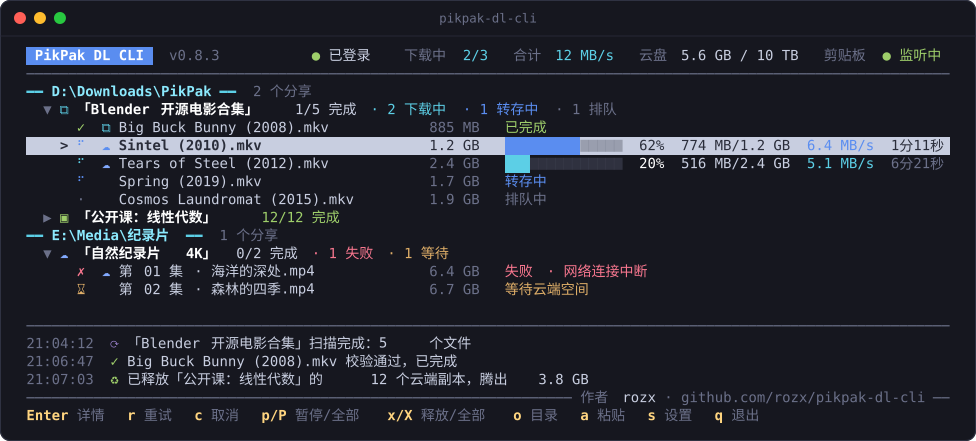
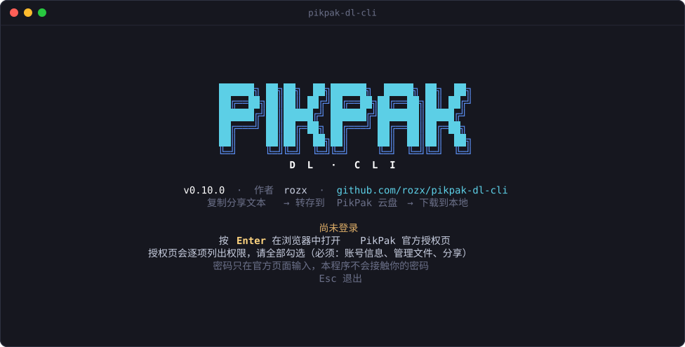
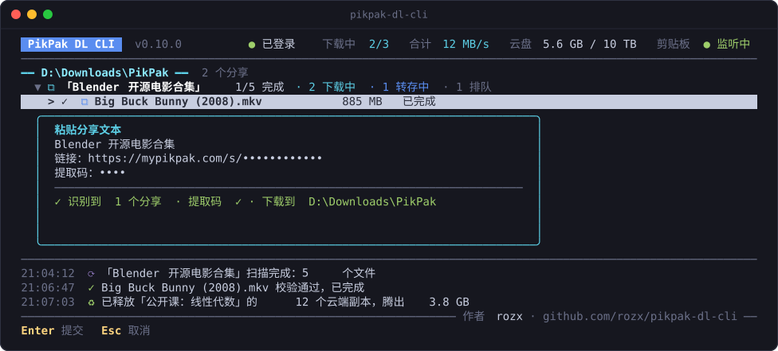
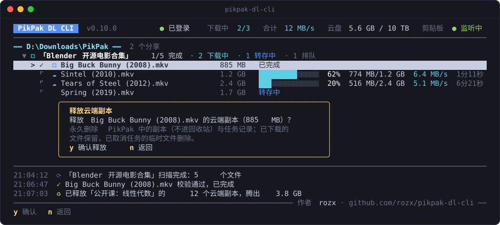
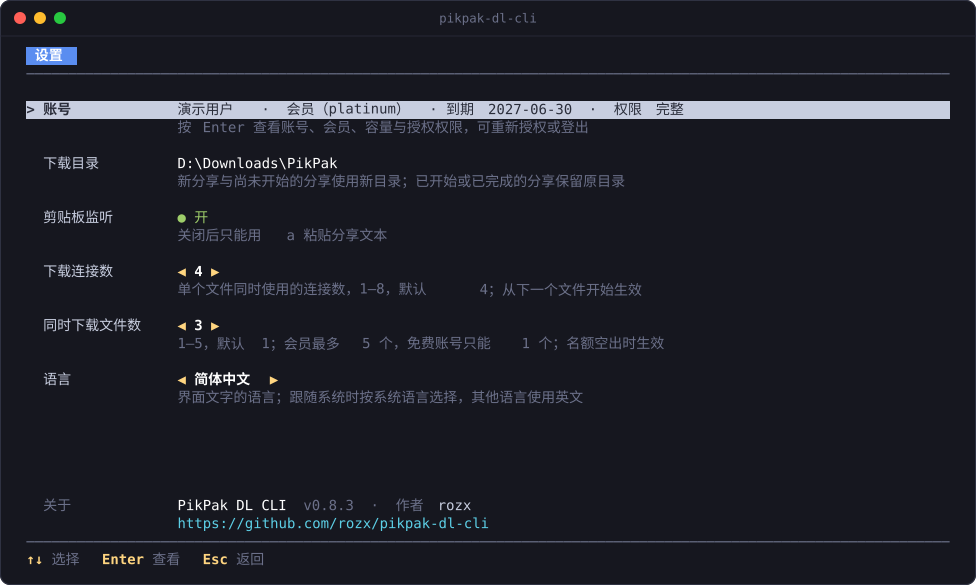

<p align="center">
  
</p>

<p align="center">
  <b>简体中文</b> · <a href="README.en.md">English</a> · <a href="README.ja.md">日本語</a>
</p>

<p align="center">
  <b>复制分享文本，剩下的交给它。</b><br>
  逐个转存 PikPak 分享中的文件，下载、校验后放进本地目录，并按需腾出云盘空间。
</p>

<p align="center">
  <a href="https://github.com/rozx/pikpak-dl-cli/releases/latest"></a>
  <a href="https://github.com/rozx/pikpak-dl-cli/releases"></a>
  <a href="https://github.com/rozx/pikpak-dl-cli/actions/workflows/release.yml"></a>
  <a href="https://github.com/rozx/pikpak-dl-cli/stargazers"></a>
  <a href="LICENSE"></a>
  <br>
  
  
  
  <a href="https://github.com/rozx/pikpak-dl-cli/commits/main"></a>
</p>

<p align="center">
  
</p>

## 为什么需要它

拿到一个 PikPak 分享，想把里面的文件下载到自己电脑上，通常要这样折腾：

1. 打开链接，输入提取码，把文件转存到自己的云盘。
2. 云盘装不下整个分享时，只能挑一部分转存，下载完删掉，再转存下一批。
3. 在网页或客户端里一个个点下载；网络一断，大文件往往要从头再来。
4. 下载完回到云盘，手动删掉这些转存副本，免得占满空间。

分享越大、文件越多，这些重复劳动就越烦人。PikPak DL CLI 把整个过程自动化：**你只需要复制分享文本**。它把云盘当作中转站，一次只转存需要的文件，下载完成并校验无误后，在空间不够时自动回收它自己创建的副本。

## 功能亮点

- **复制即下载**：在后台监听剪贴板，识别包含链接和提取码的分享文本后自动加入队列；也可以在界面里按 `a` 粘贴。
- **云盘只是中转站**：逐个文件转存，下一个文件放不下时才回收已完成的副本，最旧的先回收。分享再大也不需要等量的云盘空间。
- **只动自己创建的副本**：每份副本都有转存记录作为凭证，删除前还会重新核对远端信息。你自己存进云盘的文件，即使同名同大小，也不会被删除。
- **断点续传、内容校验**：大文件多连接分段下载；断网、退出、重启后从断点继续。下载完成后与 PikPak 提供的 GCID 比对，不一致就不会算作完成。
- **不碰你的密码**：在浏览器中通过 PikPak 官方页面授权，令牌与提取码存放在系统凭据库（Windows 凭据管理器、macOS 钥匙串、Linux Secret Service）。
- **一目了然的终端界面**：按下载目录分组显示每个分享和文件的状态、进度、速度和剩余时间；暂停、继续、重试、取消、释放云端副本都只需按一个键。
- **单个可执行文件**：Windows、macOS、Linux 各有独立产物，内含运行时，下载即用。
- **简体中文、English、日本語**：界面、命令行与授权页按系统语言自动切换，也可以手动指定。

## 快速开始

### 1. 下载

从 [Releases](https://github.com/rozx/pikpak-dl-cli/releases/latest) 下载对应平台的文件：

| 平台 | 文件 |
| --- | --- |
| Windows x64 | `pikpak-dl-cli-windows-x64.exe` |
| Windows arm64 | `pikpak-dl-cli-windows-arm64.exe` |
| macOS Apple 芯片 | `pikpak-dl-cli-darwin-arm64` |
| macOS Intel | `pikpak-dl-cli-darwin-x64` |
| Linux x64（glibc） | `pikpak-dl-cli-linux-x64` |
| Linux arm64（glibc） | `pikpak-dl-cli-linux-arm64` |

`SHA256SUMS.txt` 列出了各文件的校验和。macOS 与 Linux 下载后先加上执行权限，把文件名换成你下载的那一个，例如 Linux x64：

```sh
chmod +x ./pikpak-dl-cli-linux-x64
```

macOS 提示无法验证开发者时，可以移除下载隔离标记后再运行（Intel Mac 换成 `pikpak-dl-cli-darwin-x64`）：

```sh
xattr -d com.apple.quarantine ./pikpak-dl-cli-darwin-arm64
```

### 2. 登录

在终端中不带参数运行即进入全屏界面（Windows 推荐使用 Windows Terminal）：

```powershell
.\pikpak-dl-cli-windows-x64.exe
```

首次启动时按 Enter，在浏览器中打开 PikPak 官方授权页。授权页会逐项列出权限，请全部勾选，其中账号信息、管理文件与分享是必需的。密码只在官方页面输入。

<p align="center">
  
</p>

授权完成后选择下载目录（不存在时自动创建），之后直接进入主面板并开始监听剪贴板。

### 3. 复制分享文本

复制一段完整的分享文本，让链接和提取码同时出现在剪贴板里，例如：

```text
链接：https://mypikpak.com/s/synthetic-demo
提取码：demo
```

提取码缺失或错误时，分享行以红色显示原因，选中该分享按 Enter 输入提取码即可重新扫描，详见[复制分享文本](docs/clipboard.md)。

界面会立即显示新任务，随后依次扫描、转存、下载、校验，最后把文件放进下载目录中以分享标题命名的文件夹里。也可以按 `a` 打开粘贴框，界面会实时提示识别到的分享数和提取码：

<p align="center">
  
</p>

## 使用说明

### 主面板

列表按本地下载目录分组，每个分享下列出它的文件。分享标题后面是完成情况的汇总，文件行显示大小、状态，下载中的文件还有进度、速度与剩余时间。标题栏显示登录状态、同时下载的文件数与合计速度、云盘用量、本地剩余空间和剪贴板监听状态，底部是最近的事件。

名称前的图标表示文件现在在哪里：

| 图标 | 含义 |
| --- | --- |
| `⧉` | 本地与云端都有 |
| `▣` | 只在本地（灰色表示只下载了一部分） |
| `☁` | 只在 PikPak 云盘 |
| 留空 | 都不在 |

### 按键

| 按键 | 作用 |
| --- | --- |
| `↑` `↓` / `←` `→` / `Enter` | 选择；折叠或展开分享；查看文件详情；在等待提取码的分享上输入提取码 |
| `r` | 重试选中的文件或分享 |
| `c` | 取消（需确认）；本地文件、断点和云端副本都保留，之后可用 `r` 恢复 |
| `p` / `P` | 暂停或继续选中项；全部暂停，或有暂停时全部开始。暂停状态在重启后保持 |
| `x` / `X` | 释放选中项的云端副本；释放全部已完成任务的云端副本（都需确认） |
| `o` | 打开下载目录 |
| `a` | 粘贴分享文本 |
| `s` | 设置 |
| `q` / `Ctrl+C` | 退出（需确认）；下载会在安全点停止并保存断点，再按一次 `Ctrl+C` 立即退出 |

这些操作在下载进行中立即生效，不必等当前文件下载完。窗口至少需要 60×15，100 列宽可以放下整行按键提示；设置 `NO_COLOR` 环境变量可关闭颜色。

### 文件详情

在文件上按 Enter 查看详情：完整路径与大小、失败的原因和建议、已重试次数、本地断点、云端副本状态与本地目标路径。

<p align="center">
  
</p>

### 云端空间与释放

默认情况下你不需要管云盘空间：下一个文件放不下时，程序才会回收已完成的副本，从最旧的开始，腾出足够空间就停止。云盘空间足够时不会提前删除任何东西。

想立即腾出空间时，选中文件或分享按 `x`，或按 `X` 释放全部已完成任务的副本。确认框会说明释放的范围与大小。删除是永久的（不进回收站），本地文件保留：

- 已完成的任务在副本释放后，记录随之删除，从列表消失。
- 未完成的文件释放后保留断点，继续时从分享重新转存；分享失效后将无法完成。
- 正在下载的文件、不是本工具创建的副本不会被释放，界面只说明原因。

<p align="center">
  
</p>

### 设置

按 `s` 进入设置页：

- **账号**：按 Enter 查看账号、会员、云盘容量与授权权限，可以重新授权或登出。
- **下载目录**：新分享与尚未开始的分享使用新目录，已开始的分享保留原目录。
- **剪贴板监听**：关闭后只能用 `a` 粘贴。
- **下载连接数**：单个文件同时使用的连接数，1–8，默认 4。
- **同时下载文件数**：1–5，默认 1；会员最多 5 个，免费账号只能 1 个。
- **语言**：用 ←→ 在跟随系统、简体中文、English、日本語之间切换，界面立即改用新语言。

<p align="center">
  
</p>

### 界面语言

支持简体中文、English 和日本語，全屏界面、命令行输出、错误信息和浏览器里的授权页都使用同一种语言。默认跟随系统语言：依次读取环境变量 `LANGUAGE`、`LC_ALL`、`LC_MESSAGES`、`LANG`，Windows 上再读取系统显示语言，最后读取运行环境的默认区域设置。中文系统（包括繁体中文）显示简体中文，日文系统显示日文，其他语言显示英文。

想固定某种语言时，在设置页切换，或者运行 `config --language <auto|zh-CN|en|ja>`（`auto` 恢复跟随系统）。分享标题和文件名保持原样；`status` 输出的 JSON 字段与原因代码不随语言变化，可以放心在脚本里使用。

### 命令行

输出被重定向或在脚本中运行时不会进入全屏界面，可以使用子命令（以 Windows 为例，其他平台替换为对应的文件名）：

```powershell
.\pikpak-dl-cli-windows-x64.exe login                       # 浏览器登录，或核对已有会话
.\pikpak-dl-cli-windows-x64.exe watch --output D:\Downloads  # 纯文本的前台监听
.\pikpak-dl-cli-windows-x64.exe status                      # 只读查看任务状态，运行中也可以用
.\pikpak-dl-cli-windows-x64.exe retry f_1a2b3c4d             # 重试一个文件任务
.\pikpak-dl-cli-windows-x64.exe cancel s_1a2b3c4d            # 取消一个分享任务
.\pikpak-dl-cli-windows-x64.exe config --connections 6
.\pikpak-dl-cli-windows-x64.exe config --files 3
.\pikpak-dl-cli-windows-x64.exe config --language en         # 界面语言：auto、zh-CN、en、ja
.\pikpak-dl-cli-windows-x64.exe logout                      # 清除令牌，保留任务
```

示例中的 `f_1a2b3c4d`、`s_1a2b3c4d` 要换成 `status` 列出的文件任务 ID（以 `f_` 开头）或分享任务 ID（以 `s_` 开头）。`watch` 的进度每跨过 10% 或满 30 秒输出一行。除 `status` 外，写操作需要先停止正在运行的界面或 `watch`。完整列表见 `--help`。

### 平台说明

**Linux** 产物需要 glibc 2.28 及以上，不支持 Alpine 等 musl 发行版。运行时依赖：

- 凭据：libsecret 与可用的 Secret Service（GNOME Keyring、KWallet 等），钥匙环需已解锁。没有可用服务时无法保存登录，程序不会改用明文。
- 剪贴板：Wayland 需要 `wl-paste`（wl-clipboard），X11 需要 `xclip` 或 `xsel`。没有图形会话时可以按 `a` 粘贴。
- 打开浏览器与下载目录：`xdg-open`；打不开时手动打开终端显示的本地地址。
- 下载目录所在的文件系统需要支持不覆盖改名（ext4、xfs、btrfs 等）。

**任务库位置**：Windows 为 `%LOCALAPPDATA%\PikpakDownloader`，macOS 为 `~/Library/Application Support/PikpakDownloader`，Linux 为 `$XDG_DATA_HOME/PikpakDownloader`（未设置时为 `~/.local/share/PikpakDownloader`）。

### 安全与隐私

- 程序不收集账号密码。令牌与提取码只存放在系统凭据库，任务库只保存引用。
- 分享链接、提取码、令牌和签名下载地址不会出现在界面事件、日志或任务库里，原始剪贴板内容也不会被保存。
- 只删除有创建凭证的副本，删除前重新核对远端身份、名称、目录与内容指纹；不会清空回收站，也不会递归删除目录。
- 下载中的文件以 `.pikpak-part` 临时文件存放，完成后以不覆盖的方式改名；与已有文件重名时追加后缀。

### 更多文档

- [登录与重新授权](docs/login.md)
- [复制分享文本](docs/clipboard.md)
- [下载、校验与恢复](docs/downloads.md)
- [云端空间与回收](docs/cloud-space.md)
- [本机状态与恢复](docs/state-and-recovery.md)

> [!NOTE]
> 项目处于 0.x 阶段。实际使用验证集中在 Windows x64；macOS、Windows arm64 与 Linux 桌面尚未完整实机演练，已知问题见各版本的 [Release 说明](https://github.com/rozx/pikpak-dl-cli/releases)。遇到问题欢迎提交 [Issue](https://github.com/rozx/pikpak-dl-cli/issues)。

## 开发

技术栈为 TypeScript 与 [Bun](https://bun.sh) 1.4.2，全屏界面基于 [Ink](https://github.com/vadimdemedes/ink)（React）。

```sh
bun install --frozen-lockfile
bun run check                    # 原生模块（仅 macOS）+ 类型检查 + 全部测试
bun run dev                      # 从源码运行并监视改动，保存后自动重启
bun run start --help             # 从源码运行一次，不监视改动
bun run build bun-windows-x64    # 单文件产物输出到 dist/，默认取当前平台
bun scripts/preview-tui.tsx      # 用模拟数据预览全屏界面，不读写任务库
bun scripts/screenshots.tsx      # 用模拟数据重新生成 docs/images/ 中各语言的截图
```

- 构建目标为 `bun-{windows,darwin,linux}-{x64,arm64}`。macOS 原生模块需要 Xcode Command Line Tools 与 Node-API 头文件，可用 `NODE_API_HEADERS` 指定头文件目录；发行产物已内含运行时与原生适配，使用者无需安装这些工具。
- Windows 产物的图标与文件信息在构建时写入，图标由 `scripts/icon.ts` 按像素图生成；macOS 与 Linux 的可执行文件不带图标。
- `PIKPAK_DOWNLOADER_STATE_DIR` 可以另指任务库所在目录，供测试与本地试验使用。
- 截图中的分享、文件与账号都是虚构的。修改界面后运行 `bun scripts/screenshots.tsx` 更新截图：中文写到 `docs/images/`，英文与日文写到 `docs/images/en/`、`docs/images/ja/`。
- 界面文字在 `src/i18n/messages/`：`zh-CN.ts` 是基准，`en.ts` 与 `ja.ts` 缺条目时类型检查失败。

架构、约定与测试说明见 [AGENTS.md](AGENTS.md)。需求变更走 [OpenSpec](openspec/) 流程，规格在 `openspec/specs/`。发布时在 `release/x.y.z` 分支写好 `docs/releaseNotes/vx.y.z.md` 并创建带 `release` 标签的 PR，合并后 GitHub Actions 在三个平台上检查、构建并创建 Release。

## 许可

[MIT](LICENSE) © rozx
